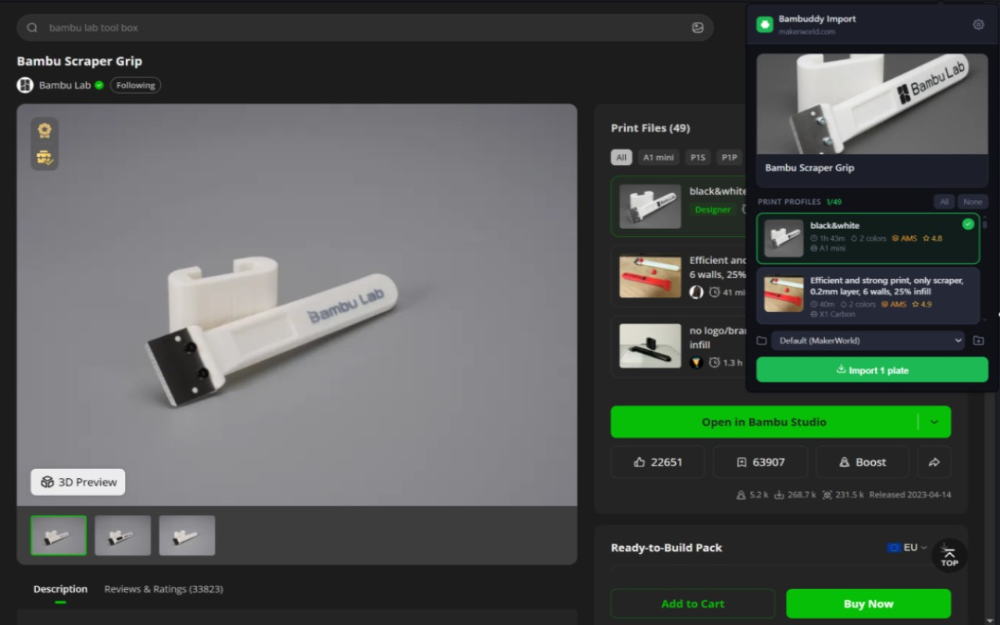

# Bambuddy Browser Import

Import MakerWorld print profiles into your [Bambuddy](https://github.com/maziggy/bambuddy) library
from the browser — pick the plates, pick the folder, one click. Works in Chrome and Firefox from the
same codebase.

Features, configuration, usage, security and troubleshooting are documented in [`docs/`](docs/).

## Requirements

- A running [Bambuddy](https://github.com/maziggy/bambuddy) instance recent enough to have the
  library folders API (`/api/v1/library/folders`) and the MakerWorld endpoints
  (`/api/v1/makerworld/*`)
- A Bambu Cloud account linked in Bambuddy under **Settings → Bambu Cloud** — Bambuddy downloads
  the profiles with that token
- A Bambuddy API key with **Manage Library** and **Allow cloud access** enabled
- Chrome, Chromium, Edge, Brave or any other Manifest V3 browser, or Firefox ≥ 140

## Setup

### Install

From the stores:

- [Chrome Web Store](https://chromewebstore.google.com/detail/kcffnknnapkmkabmkbghccgjfcgiobgb)
- [Firefox Add-ons](https://addons.mozilla.org/firefox/addon/bambuddy-browser-import/)

Or load it yourself from a clone or a [release](https://github.com/rojosinalma/bambuddy-browser-import/releases/latest) `.zip`:

- **Chrome / Chromium / Edge / Brave** — open `chrome://extensions/`, enable **Developer mode**,
  click **Load unpacked** and select the folder, then pin the icon via the puzzle-piece menu.
- **Firefox** — open `about:debugging#/runtime/this-firefox`, click **Load Temporary Add-on…** and
  select `manifest.json`. Temporary add-ons are removed when Firefox exits; install from Firefox
  Add-ons for a permanent, signed copy.

### Connect it to Bambuddy

Click the extension icon → gear (⚙), or right-click the icon → **Options**.

1. **Bambuddy URL**

   | Setup | Example URL |
   |---|---|
   | Local network | `http://192.168.1.100:8000` |
   | Docker on same machine | `http://localhost:8000` |
   | Reverse-proxied with HTTPS | `https://bambuddy.example.com` |

   Saving asks the browser for permission to reach that one origin — the extension does not hold a
   blanket host permission.

2. **API key** — create a dedicated key in Bambuddy under **Settings → API Keys → Create API Key**
   with **Manage Library** (saving files, importing from MakerWorld, listing/creating folders) and
   **Allow cloud access** (Bambuddy uses your Bambu Cloud token to download from MakerWorld). Paste
   it, click **Test Connection**, then **Save**. The test runs three checks: `GET /health`
   (reachable), `GET /api/v1/system/info` (key valid, shows version), `GET /api/v1/makerworld/status`
   (cloud token present).

Then open any model on [makerworld.com](https://makerworld.com) and click the toolbar icon — see
[`docs/usage.md`](docs/usage.md).

## License

[MIT](LICENSE). Originally based on [wolfrage76/Bambuddy-Extension](https://github.com/wolfrage76/Bambuddy-Extension).
[Privacy Policy](PRIVACY.md) · [Terms of Service](TERMS.md) · Site: https://bambuddy-import.rojo.dev
