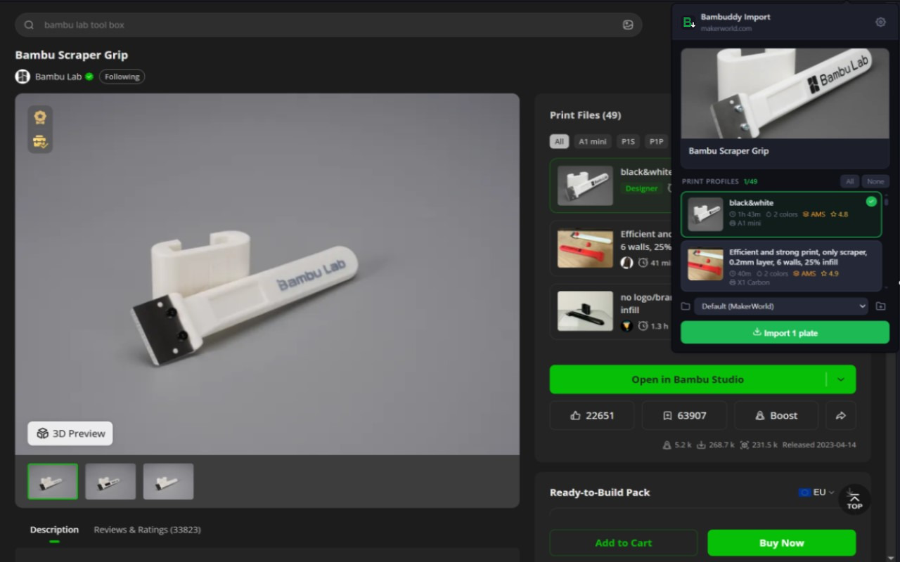
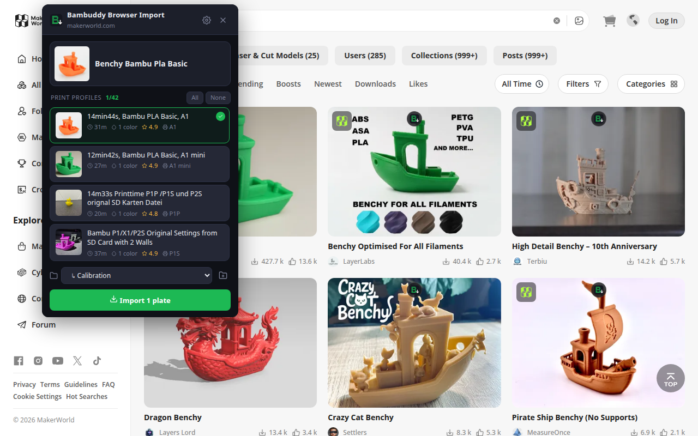
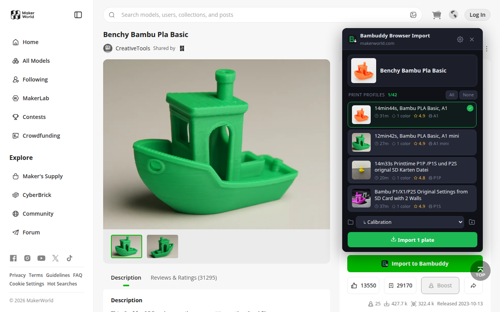
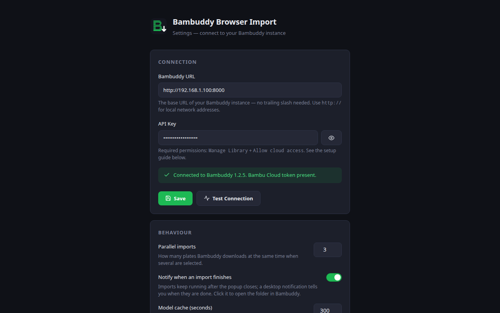

# Bambuddy Browser Import

[](https://github.com/rojosinalma/bambuddy-browser-import/actions/workflows/check-extension.yml)
[](https://github.com/rojosinalma/bambuddy-browser-import/actions/workflows/release.yml)
[](https://github.com/rojosinalma/bambuddy-browser-import/releases/latest)
[](LICENSE)



| | | |
|---|---|---|
|  |  |  |
| Import from the search results | Or from the model page | Connect to your Bambuddy |

Import MakerWorld print profiles into your [Bambuddy](https://github.com/maziggy/bambuddy) library
from the browser — pick the plates, pick the folder, one click. Works in Chrome and Firefox from the
same codebase.

Features, configuration, usage, security and troubleshooting are documented in [`docs/`](docs/);
the design is in [`docs/SDD.md`](docs/SDD.md).

## Features

1. **Multi-select** — import one plate, a few or all of them at once; each card shows print time,
   colours, AMS use and rating.
2. **Folder picker** — pick the library folder or create a new one; the last folder is remembered.
3. **Import from the page** — an import bubble on every MakerWorld thumbnail and an
   **Import to Bambuddy** button on model pages, next to the toolbar popup.
4. **Background imports** — closing the popup does not cancel the job; the badge counts down and a
   notification opens the folder in Bambuddy when it is done.
5. **Already-imported detection** — plates already in your library are not downloaded again.
6. **Fast popup** — models are resolved on page load and cached; thumbnails are fetched small.
7. **Your server only** — talks to your Bambuddy URL and the MakerWorld page you are on. No backend,
   no telemetry.

Details: [`docs/features.md`](docs/features.md).

## Requirements

| Dependency | Minimum | Notes |
|---|---|---|
| [Bambuddy](https://github.com/maziggy/bambuddy) | 0.2.4.5 | first release with the **Manage Library** and **Allow cloud access** API-key scopes and the `/api/v1/makerworld/*` endpoints |
| Bambu Cloud account | — | linked in Bambuddy under **Settings → Bambu Cloud**; Bambuddy downloads the profiles with that token |
| Bambuddy API key | — | created in **Settings → API Keys** with **Manage Library** and **Allow cloud access** enabled |
| Chrome, Chromium, Edge, Brave | 116 | any Manifest V3 browser of that generation |
| Firefox | 140 | |

## Installation

The stores are the recommended way: they sign the extension and keep it up to date.

1. [Chrome Web Store](https://chromewebstore.google.com/detail/kcffnknnapkmkabmkbghccgjfcgiobgb)
   — Chrome, Chromium, Edge, Brave.
2. [Firefox Add-ons](https://addons.mozilla.org/firefox/addon/bambuddy-browser-import/)

Without the store, use the files attached to each
[release](https://github.com/rojosinalma/bambuddy-browser-import/releases/latest):

| File | What it is | Linux | Windows |
|---|---|---|---|
| `…-chrome.zip` | the extension files | Load unpacked | Load unpacked |
| `…-chrome.crx` / `…-chrome.crx.zip` | signed Chrome package, the same file uploaded to the Chrome Web Store | drag-and-drop install | drag-and-drop install after a one-time registry entry |
| `…-firefox.xpi` | unsigned Firefox package | temporary add-on only | temporary add-on only |

These copies do not update by themselves: install the next release the same way. Their extension
id is not the store's, so settings do not carry over, and installing both gives you two copies —
remove one first.

### Chrome / Chromium / Edge / Brave from the `.zip` (Linux and Windows)

1. Download `bambuddy-browser-import-<version>-chrome.zip`.
2. Extract it to a folder you keep — the browser loads the extension from there, so do not delete
   or move it.
   - a. Linux: `unzip bambuddy-browser-import-<version>-chrome.zip -d ~/bambuddy-browser-import`
   - b. Windows: right-click the file → **Extract All…** → choose a folder, for example
     `C:\Users\<you>\bambuddy-browser-import`.
3. Open `chrome://extensions/` (Edge: `edge://extensions/`, Brave: `brave://extensions/`).
4. Turn on **Developer mode**.
5. Click **Load unpacked** and select the extracted folder (the one with `manifest.json`).
6. Pin the icon via the puzzle-piece menu.

To update: extract the new zip into the same folder, then click the reload arrow on the
extension's card. A clone of this repo works the same way: select the clone folder in step 5.

### Chrome / Chromium / Edge / Brave from the `.crx` (Linux and Windows)

The `.crx` installs with id `egjfnjgkpidiplpekbneaffeofbpkjpm` on every release, so installing the
next one over it keeps your settings.

On Windows, the browser blocks a `.crx` from outside the Chrome Web Store unless its id is on the
`ExtensionInstallAllowlist` policy. Do this once, before the first install (Linux skips it):

1. Save this as `bambuddy-browser-import.reg`. It covers Chrome, Chromium, Edge and Brave; lines
   for a browser you do not use are harmless. If a browser already has an allowlist entry `"1"`,
   change `"1"` to the next free number for that browser.

   ```reg
   Windows Registry Editor Version 5.00

   [HKEY_LOCAL_MACHINE\SOFTWARE\Policies\Google\Chrome\ExtensionInstallAllowlist]
   "1"="egjfnjgkpidiplpekbneaffeofbpkjpm"

   [HKEY_LOCAL_MACHINE\SOFTWARE\Policies\Chromium\ExtensionInstallAllowlist]
   "1"="egjfnjgkpidiplpekbneaffeofbpkjpm"

   [HKEY_LOCAL_MACHINE\SOFTWARE\Policies\Microsoft\Edge\ExtensionInstallAllowlist]
   "1"="egjfnjgkpidiplpekbneaffeofbpkjpm"

   [HKEY_LOCAL_MACHINE\SOFTWARE\Policies\BraveSoftware\Brave\ExtensionInstallAllowlist]
   "1"="egjfnjgkpidiplpekbneaffeofbpkjpm"
   ```

2. Double-click the file and accept the prompts (needs administrator rights).
3. Close every browser window and start the browser again.
4. Open `chrome://policy` (Edge: `edge://policy`) and check that **ExtensionInstallAllowlist**
   shows the id.

The browser then shows "Managed by your organization"; that is the policy you just added. To undo
it, delete the `ExtensionInstallAllowlist` keys again in `regedit`.

Install (Linux and Windows):

1. Download `bambuddy-browser-import-<version>-chrome.crx.zip` and extract it. The browser drops a
   bare `.crx` downloaded from outside the Web Store, which is why the zipped copy exists.
2. Open `chrome://extensions/` (Edge: `edge://extensions/`, Brave: `brave://extensions/`) and turn
   on **Developer mode**.
3. Drag the `.crx` file from your file manager onto the extensions page and confirm **Add
   extension**.

### Firefox from the `.xpi` or the `.zip` (Linux and Windows)

Release Firefox installs only add-ons signed by Mozilla, so for a permanent copy use
[Firefox Add-ons](https://addons.mozilla.org/firefox/addon/bambuddy-browser-import/). To try a
release file:

1. Open `about:debugging#/runtime/this-firefox`.
2. Click **Load Temporary Add-on…** and select the `.xpi`, or `manifest.json` in an extracted
   `.zip` or a clone.

Firefox removes temporary add-ons when it exits.

### Connect it to Bambuddy

Click the extension icon → gear (⚙), or right-click the icon → **Options**.

1. **Bambuddy URL**

   | Setup | Example URL |
   |---|---|
   | Local network | `http://192.168.1.100:8000` |
   | Docker on same machine | `http://localhost:8000` |
   | Reverse-proxied with HTTPS | `https://bambuddy.example.com` |

   Saving asks the browser for permission to reach that one origin — the extension does not hold a
   blanket host permission.

2. **API key** — create a dedicated key in Bambuddy under **Settings → API Keys → Create API Key**
   with **Manage Library** (saving files, importing from MakerWorld, listing/creating folders) and
   **Allow cloud access** (Bambuddy uses your Bambu Cloud token to download from MakerWorld). Paste
   it, click **Test Connection**, then **Save**. The test runs three checks: `GET /health`
   (reachable), `GET /api/v1/system/info` (key valid, shows version), `GET /api/v1/makerworld/status`
   (cloud token present).

## Usage

Open any model on [makerworld.com](https://makerworld.com), click the toolbar icon (or the
**Import to Bambuddy** button on the page), tick the plates, pick the folder and click
**Import N plates**. The badge counts down while Bambuddy downloads; a notification opens the folder
when it is done. Step by step, with the in-page buttons and the status indicators:
[`docs/usage.md`](docs/usage.md).

## Development

There is no build step: clone the repo and load the folder as an unpacked extension (see
Installation). After editing a file, hit *Reload* on the extensions page. The checks the release
pipeline runs:

```sh
for f in *.js; do node --check "$f"; done
npx --yes web-ext lint --source-dir . --warnings-as-errors=false
```

`bin/dev-build` packs a dev zip and a dev-key-signed `.crx`. Everything else — code style, the
`dev-settings.json` seed, what to test by hand, how a release is cut — is in
[CONTRIBUTING.md](CONTRIBUTING.md).

## License

[AGPL-3.0](LICENSE) · Copyright (C) 2026 rojosinalma. Started from
[wolfrage76/Bambuddy-Extension](https://github.com/wolfrage76/Bambuddy-Extension); releases up to
0.9.6 were MIT-licensed and the MIT notice for the inherited parts is kept at the end of
[LICENSE](LICENSE).
[Privacy Policy](PRIVACY.md) · [Terms of Service](TERMS.md) · Site: https://bambuddy-import.rojo.dev
